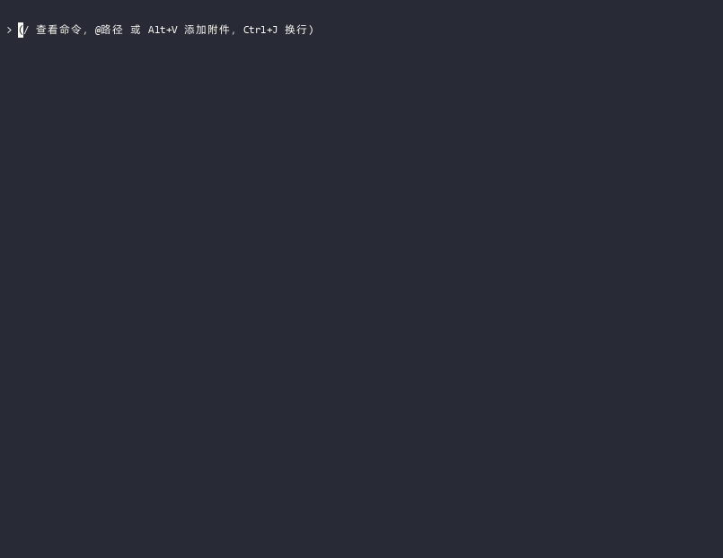

# cove

**在终端里干活的中文 AI 编程助手。** 读代码、改代码、跑命令和测试；改坏了能整体撤销，花了多少钱算得清清楚楚。

一个 `cove.exe`，不用装运行时；接 DeepSeek、OpenAI、Anthropic、AWS Bedrock、通义、Kimi、智谱、豆包、OpenRouter，或任何 OpenAI 兼容接口（包括本地模型）。



<sub>真实录制，没有剪辑：先修好一个边界条件 bug，再加会员折扣需求、补 4 个测试，共 6 个测试通过，花费 $0.01。</sub>

## 为什么用 cove

- **撤销连 Shell 的改动一起算。** 每个任务动手前，cove 都会给整个工作区拍一个 Git 快照（存在私有仓库里，不碰你的 `.git`），脚本改的源文件也能 `/undo` 回去；`node_modules`、`target`、`dist` 这类被忽略的目录不在快照里。恢复本身也能再撤销。
- **花多少钱，算得准。** 按实际作答的模型计价，缓存读写分开算；状态行实时显示上下文长度和本会话花费。`/status cost` 按月、按模型出账，可导出 CSV。
- **长会话不越用越慢。** 旧工具输出自动挪到文件里；上下文到 40 万 token 前就压缩（实测超过这个量，每次响应明显变慢），摘要提前在后台写好，不用停下来等。较新的 Claude 模型（Opus 4.5、Sonnet 4.6、Haiku 4.5 及之后）提示缓存保留 1 小时，你中途停下来想一会儿，回来照样命中。
- **大模型和快模型自动分工。** 配置了快速模型（`/model fast <名称>`）后，简单的事交给它，复杂的才用主模型；压缩、标题这类后台活也走快速模型。
- **越用越懂你的项目。** 你纠正过的做法、反复踩过的坑，cove 会写成项目规则（`.cove/rules.md`，跟着仓库走），之后每个任务都遵守；提交前再用 AI 按这些规则和真实缺陷审查一遍暂存的改动，有问题就不提交。你说的要求要是和具体项目无关（比如"改动尽量小""先审查再推送"），cove 会在下一个输入提示前问一句要不要在所有项目里都这样，同意了才记成全局偏好。
- **接上项目自己的审查。** 项目已经有一套和 CI 同样规则的审查脚本时，在 `.cove.json` 写上 `review_commands`（`/config trust` 后生效）：每个任务改完、验证通过后自动运行，有 HIGH 及以上的问题就交回模型修，修完再审，最多 3 轮，同样的问题连着出现或模型认为不成立就停下说明；审查脚本被改动或删除时，这次审查作废。
- **原地打转会停下来。** 连续 12 轮既没有新的改动、也没有拿到新信息（比如同一个"连接被拒绝"换着命令反复出现），cove 会停下来，列出反复出现的错误和改过的文件，问你是停下总结、换个思路还是照旧继续；`-p` 下直接总结后结束。
- **一个需求，两个方案。** `/race 需求` 让主模型和快速模型各在一个独立的 worktree 里实现（没配置快速模型时，B 方案用主模型换一种思路），用同一组构建、测试命令验证，比较改动和花费后选一个应用。

另外：界面和提示全中文；会话、长期记忆、历史标题都自动保存；支持 MCP、技能、Hooks 和插件。

## 快速开始

**安装**

- 把 `cove.exe` 放到一个固定目录（如 `D:\tools`），并把这个目录加入 `PATH`；
- 或者从源码构建：`cargo build --release`，产物在 `target\release\cove.exe`。

主要在 Windows 上开发和测试。

**第一次运行**

```powershell
cd D:\my-project
cove
```

第一次会进入设置向导：选服务商、确认模型、输入 API key。配置保存在 `%USERPROFILE%\.cove\config.json`，`/config setup` 可以重新设置。

**然后直接说要做什么**

```text
> 这个项目的入口在哪里，整体结构是怎样的
> 修复 OrderServiceTests 里失败的测试，并跑一遍相关测试
> 给 /api/orders 加分页参数，照着现有接口的写法来
```

每一步都看得见：读了什么、改了哪几行、命令的退出码，完成时列出模型调用次数、token 和花费（见上面的演示）。

## 日常操作

| 想做什么 | 怎么做 |
| --- | --- |
| 让它看文件或截图 | 消息里写 `@路径`（Tab 补全），或把图片拖进终端；Windows 上 Alt+V 粘贴剪贴板图片 |
| 运行中补充要求 | 直接输入，下一步就交给它；开头加 `!` 立即打断当前回答 |
| 停下当前任务 | 连按两次 Esc，或 Ctrl+C |
| 接着上次做 | 输入 `继续`，或 `/continue` |
| 看它改了什么 | `/diff` |
| 提交 | `/commit 消息`：先验证、再审查（按项目规则的 AI 审查，或项目自己的审查命令）；`--no-review` 跳过审查 |
| 看或改规则和偏好 | `/rules` 列出全局偏好和项目规则；`/rules add <规则>`、`/rules add global <偏好>`；`/rules remove <n>`、`/rules remove g<n>`；`/rules promote <n>` 把项目规则提升为全局偏好 |
| 撤销 | `/undo` 列出回滚点，`/undo #n` 预览，`/undo confirm` 执行 |
| 翻看之前的问答 | `/turns` 打开阅读器，只看每轮的提问和结论，可拖选复制 |
| 看完整的工具输出 | `/expand`，或 `/expand 3`（看 `#3`） |
| 看花费和用量 | `/usage`（本会话）、`/cost`（按月） |
| 换行不发送 | Ctrl+J、Shift+Enter 或 Alt+Enter |
| 退出 | `/exit` 或 Ctrl+D，会话自动保存 |

输入 `/` 列出所有命令，`/help <命令>` 看某条的详细用法。

## 权限：它要改文件或跑命令时

默认模式下，读代码、改项目里的文件，以及不会改动东西的命令（构建、测试、本地 git 提交）直接做，不打扰你。会删改文件的命令、推送远端、安装软件、改系统设置、写项目外的文件，才先问你：

```text
┌ 需要批准 · 原因：推送到远端（git push）
│ 运行 shell 命令（无沙箱）：git push origin main
  1. 允许这一次 (y)
  2. 本次会话不再询问 (s) - git 常规操作（push、pull、merge 等；--force、reset、clean 仍会询问）
  3. 本项目以后都不再询问 (a) - git 常规操作（push、pull、merge 等；--force、reset、clean 仍会询问）
  4. 拒绝 (n) - 或直接输入理由，告诉模型该怎么做
└ 按 y/s/a 直接选，或上下键选择后回车；直接回车 = 拒绝
```

不想用 y/n 拒绝时，可以直接打字，比如"先别推送，等我看完"。这句话会作为理由交给模型，它换个做法继续，任务不中断。

`/mode` 切换模式（加 `save` 记住）：

| 模式 | 效果 |
| --- | --- |
| `default` | 项目内的修改和无副作用的命令直接做，有风险的命令先问 |
| `plan` | 只读，适合先让它分析、出方案 |
| `auto` | 在 `default` 基础上，网络工具和已信任的扩展进程也直接放行；删除项目里的文件时，只要每个文件都在这次调用前的快照里（能用 `/undo` 恢复），也直接删。删目录、带通配符、删被 Git 忽略的文件仍然先问 |
| `bypass` | 全部直接做，只在你信任这个任务时用 |

任何模式下都会拦截危险命令，比如删除整个磁盘或家目录、格式化、下载后直接执行脚本。

`default` 和 `auto` 下，一个任务里只要有操作被拒绝（你选了拒绝，或者没有终端可以询问），这个任务后面再运行它自己新建或改过的脚本（`python x.py`、`./x.sh` 等）也要先问，免得把被拒的命令包进脚本里执行。项目里原有的脚本不受影响，下一个任务重新计算。

`auto` 下，写在命令行里的代码（`python -c "..."`、`python - <<'PY'`、`node -e` 等）和本任务写的脚本一样对待：没有操作被拒过时直接运行，被拒过之后要先问。代码来自管道或 `$(...)`、含变量展开、同一行还有别的要审批的操作时照旧先问；`default` 下照旧先问。

## 会话、历史和撤销

- **自动保存**：在同一个目录再次启动时会提示上次的任务，输入 `继续` 接着做。
- **找回旧会话**：`/resume` 打开历史面板，按日期分组，标题由模型自动生成。直接打字筛选，Tab 预览，Ctrl+R 改名，回车恢复；`/resume all` 看所有目录。
- **回滚点**：每个任务第一次动手前一个，会改东西的 Shell 命令和子 Agent 前各一个。每个项目保留最近 50 个、30 天以内的回滚点，可以整体恢复，也可以只恢复指定文件（`/undo files #n <文件…>`）。
- **上下文**：输入行上方一直显示上下文长度和本会话花费；快到压缩线时变黄。告一段落时可以 `/compact` 主动压缩。换话题时用 `/handoff`：模型写一份交接摘要（做了什么、没做完什么），cove 附上改过的文件和提交，在新会话里从这份摘要接着做，上下文一下子变小；原会话原样保留，`/back` 回去。什么都不想带就用 `/new`。

## 进阶

**拆成子任务并行做**

```text
把这个需求拆成几个子任务并行做：A 改 dispatcher，B 改 margin，C 补测试（C 依赖 A 和 B）
用后台 Agent 分别在独立分支里修这三个 bug，做完告诉我
```

- 子 Agent 按依赖顺序并行跑；
- 后台 Agent 在各自的 git worktree 里工作，不影响你的工作区。`/status agents` 查看进度，合并哪个由你决定。

**大范围调查交给 explore**

- 要看很多文件才能回答的问题（谁调用了它、配置怎么一层层传下来），模型会交给只读的 explore 子 Agent。它默认用快速模型（`model_fast`），同一次回复里的几个 explore 并行跑；
- 主上下文只收一份结论和 `路径:行` 证据（最多 6 KB），cove 在本地核对每条证据的位置是否存在。想让 explore 用主模型，配置 `"explore_model": "main"`。

**改了会影响谁**

- 改了函数、类型的任务收尾时，cove 在本地列出改动的符号在其他文件里被谁使用、这些地方有没有测试引用；删掉或改了签名的函数还有没被测试的调用方时，交给模型核对一次；
- 审阅已有的提交或 MR：`/changes impact origin/main...HEAD`（也认 `A..B` 和单个提交）。按名字匹配，可能有误报或漏报；`"change_impact": "off"` 关闭收尾的这一段。

**一个需求两个方案**

```text
/race 给订单列表加按状态筛选
```

- 结果列出两个方案各自的模型、验证结果、改动的文件数和增删行数、花费；
- `/changes diff race:<id>:a` 看补丁，`/changes apply race:<id>:a confirm` 应用；
- 要求工作区干净。验证命令取自配置的 `done_verify_commands`，没配置时自动推断（`cargo test`、`go test`、`npm test`、`dotnet build` 等）。推断不出时，方案标为"未验证"，不能直接应用。

**连接外部服务（MCP）**

在 `config.json` 里加上服务器，例如 Atlassian：

```json
"mcp_servers": {
  "atlassian": { "type": "http", "url": "https://mcp.atlassian.com/v2/mcp" }
}
```

重启后 `/mcp login atlassian` 在浏览器里授权，之后就可以说"看一下 PE-1234，按需求实现"。

**技能与记忆**

- **技能**：写好的做事方法（代码审查、TDD、调试等）。`/skills` 列出全部，`/技能名` 直接用，`/config skills marketplace` 浏览内置的技能市场。自己写的放在 `%USERPROFILE%\.cove\skills\<名字>\SKILL.md`，改完不用重启。
- **记忆**：项目约定会被自动记下，下次自动带上。项目记忆多的时候，只带和当前任务相关的几条，再加一份目录；全局记忆放本机的环境事实，每次完整带上。`/memory` 查看和管理。
- **全局偏好**：你在所有项目里都希望遵守的做法（比如"用中文回复"），放在 `%USERPROFILE%\.cove\preferences.md`，每个项目都遵守，项目规则和你当前的要求优先。只有你同意的才会写进去：`/rules add global`，或者回答 cove 的提问。

**不进交互界面，直接运行**

```powershell
cove -p "解释这个项目的入口"                        # 分析类任务，完成后退出
cove -p "修复失败的测试"                            # 项目内的文件修改、构建和测试直接做
cove -p "部署到生产" --permission auto              # 推送、装软件等有副作用的操作
Get-Content error.log | cove -p "这个报错是什么原因"   # 把管道内容一起交给它
```

`-p` 不会询问你，需要批准的操作直接失败。项目内的文件修改和构建、测试在默认模式下直接做；推送远端、安装软件这类有副作用的操作才需要加 `--permission auto`。

## 配置

- 用户配置：`%USERPROFILE%\.cove\config.json`，完整示例见 [config.example.json](docs/config.example.json)。
- 界面里直接改：`/model <名称>`、`/model fast <名称>`、`/config api_key`、`/config effort high`。
- 项目设置：放在项目根目录的 `.cove.json`。涉及执行命令或花钱的设置，要先 `/config trust` 信任这个项目才生效。
- 遇到问题：`/doctor` 检查配置、密钥、网络和环境。

## 安全须知

- cove 运行的命令拥有你的系统权限，不是沙箱。批准前看一眼命令；重要项目先提交，或者在新分支上做。
- 撤销覆盖工作区里的文件，撤销不了已经推送的提交、已经发出的请求等外部影响。
- 会话、记忆和快照都在 `%USERPROFILE%\.cove`，里面有代码片段，没有加密，不要共享这个目录。
- 费用按单价估算，以服务商账单为准。

## 文档

- [技术参考](docs/reference.md)：所有命令、配置项和行为细节
- [扩展](docs/extensions.md)：MCP、技能、Hooks、插件
- [架构设计](docs/design.md)：模块划分与实现原理
- [性能说明](docs/performance.md)：提速机制与测量口径
- [优化记录](docs/optimizations/README.md)：每次改动要解决什么、怎么验证的
- [真实模型评测](evals/README.md)：用真实模型跑一组任务，衡量改提示词、换模型前后的效果
- [开发须知](AGENTS.md)：改代码前必读，禁止的写法和踩过的坑

MIT License
